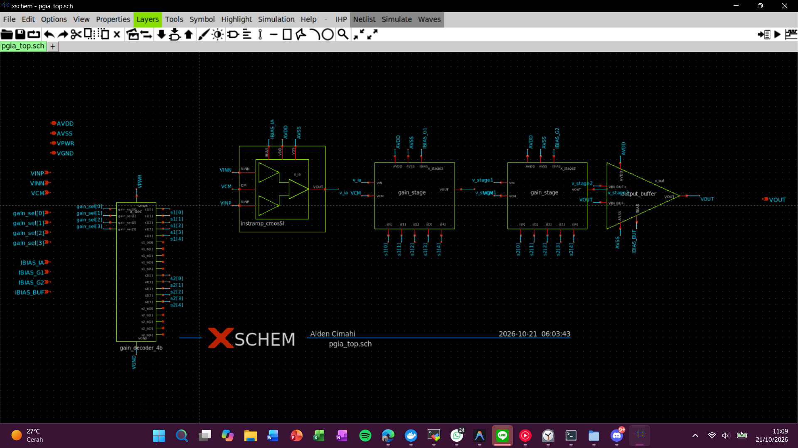
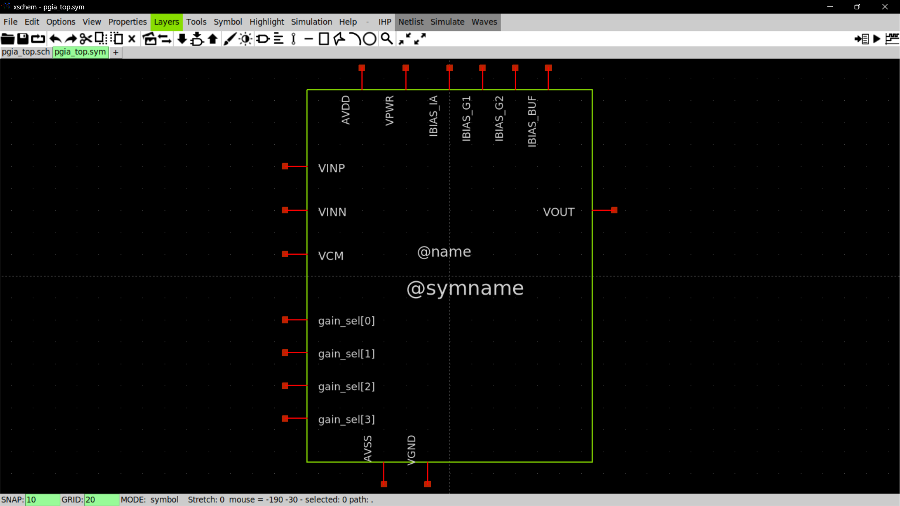
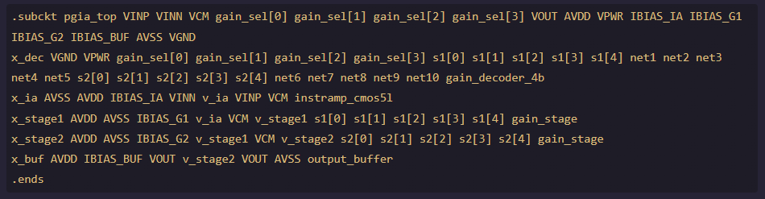
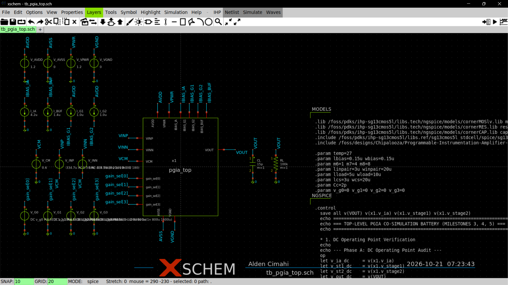

# Top-Level Programmable Gain Instrumentation Amplifier (`pgia_top`)

`pgia_top` is the master top-level schematic and hierarchical cell for the complete mixed-signal Programmable Instrumentation Amplifier (PGIA) implemented on **IHP SG13CMOS5L** ($1.2\,\text{V}$ core).

It integrates the front-end fixed instrumentation amplifier, two cascaded binary gain stages, an analog output buffer, and the 4-bit digital gain decoder into a single unified IP block conforming to Chipalooza Challenge #2 and the Slot 9 wrapper specification.

---

## 1. Top-Level Signal Chain Architecture

```
                                                 pgia_top
┌────────────────────────────────────────────────────────────────────────────────────────────────────────┐
│                                                                                                        │
│  VPWR ──┐                                                                                              │
│  VGND ──┼──┐                                                                                           │
│         │  │   ┌──────────────────┐ s1[4:0]                                                           │
│ gain_sel┼──┼──►│ gain_decoder_4b  ├────────────────────────────┐                                       │
│  [3:0]  │  │   │  (1.2V Digital)  ├────────────┐               │                                       │
│         │  │   └──────────────────┘ s2[4:0]    │               │                                       │
│         │  │                                   │               ▼                                       │
│         │  │                             ┌─────┼───────────────┴────────┐                              │
│         │  │                             │     │       gain_stage_1     │                              │
│         │  │                             │     │   (Inverting Switched) │                              │
│         │  │                             │     │   1x .. 32x (0..30 dB) │                              │
│         │  │                             │     ▼                        │                              │
│         │  │                             │   ┌────────────────────────┐ │                              │
│ VINP ───┼──┼───►┌────────────────┐       │   │        v_stage1        │ │                              │
│ VINN ───┼──┼───►│ instramp_cmos5l├──v_ia─┼──►│ (Inverts about 0.6V)   ├─┼────────┐                     │
│         │  │    │   (Fixed 8x /  │       │   └────────────────────────┘ │        │                     │
│ VCM ────┼──┼───►│    18.06 dB)   │       │               ▲          │ │        │                     │
│         │  │    └────────┬───────┘       └───────────────┼──────────┼─┘        │                     │
│         │  │             │                               │          │          ▼                     │
│         │  │             │                   AVDD, AVSS ─┤          │   ┌──────────────────────────┐ │
│         │  │             │                   VCM (0.6V) ─┤          │   │       gain_stage_2       │ │
│         │  │             │                   IBIAS_G1 ───┘          │   │   (Inverting Switched)   │ │
│         │  │             │                                          │   │   1x .. 32x (0..30 dB)   │ │
│         │  │             │                                          │   │                          │ │
│         │  │             │                                          │   │   v_stage2               │ │
│         │  │             │                                          │   │ (Inverts BACK to normal) ├─┼──┐
│         │  │             │                                          │   └──────────┬───────────────┘ │  │
│         │  │             │                                          │              │                 │  │
│         │  │             │                                          │  AVDD, AVSS ─┤                 │  │
│         │  │             │                                          │  VCM (0.6V) ─┤                 │  │
│         │  │             │                                          │  IBIAS_G2 ───┘                 │  │
│         │  │             │                                          │                                │  │
│         │  │             ▼                                          ▼                                ▼  ▼
│         │  │       IBIAS_IA (4.2uA)                           IBIAS_BUF (1.4uA)                ┌───────────┐
│         │  │                                                                                   │output_buf │
│         │  │                                                                                   │ (Follower)├──► VOUT
│         │  │                                                                                   └───────────┘
│         │  │                                                                                         ▲
│         ▼  ▼                                                                                         │
│     AVDD, AVSS ──────────────────────────────────────────────────────────────────────────────────────┘
└────────────────────────────────────────────────────────────────────────────────────────────────────────┘
```


*PGIA Top Level Schematic*

### Signal Polarity & Gain Composition:
1. **Frontend IA (`instramp_cmos5l`):** Non-inverting differential to single-ended preamplifier:
   $$v_{ia} = V_{CM} + 8 \cdot (V_{INP} - V_{INN})$$
2. **Gain Stage 1 (`x_stage1`):** Inverting binary feedback ladder ($1\times \dots 32\times$):
   $$v_{stage1} = V_{CM} - A_{G1} \cdot (v_{ia} - V_{CM})$$
3. **Gain Stage 2 (`x_stage2`):** Inverting binary feedback ladder ($1\times \dots 32\times$):
   $$v_{stage2} = V_{CM} - A_{G2} \cdot (v_{stage1} - V_{CM}) = V_{CM} + A_{G1} A_{G2} \cdot (v_{ia} - V_{CM})$$
4. **Output Buffer (`x_buf`):** Non-inverting unity-gain voltage follower:
   $$V_{OUT} = v_{stage2} = V_{CM} + 8 \cdot A_{G1} A_{G2} \cdot (V_{INP} - V_{INN})$$

Because both programmable gain stages are inverting, the complete composite chain is **strictly non-inverting**, providing **11 monotonic $6\,\text{dB}$ gain steps** from **$18.06\,\text{dB}$ ($8\times$)** up to **$78.26\,\text{dB}$ ($8192\times$)**.

---

## 2. Top-Level Sub-Block Instantiation Matrix

| Instance | Cell Name | Symbol | Schematics | Role & Connections |
|:---|:---|:---|:---|:---|
| **`x_dec`** | `gain_decoder_4b` | `gain_decoder_4b.sym` | Layout Macro (`.spice`) | Inputs: `gain_sel[3:0]`. Outputs: `s1[4:0]`, `s2[4:0]`. Supplies: `VPWR` ($1.2\,\text{V}$), `VGND` ($0\,\text{V}$). |
| **`x_ia`** | `instramp_cmos5l` | `instramp_cmos5l.sym` | `instramp_cmos5l.sch` | Fixed $8\times$ IA. Inputs: `VINP`, `VINN`, `VCM`, `IBIAS_IA` ($4.2\,\mu\text{A}$). Output: `v_ia`. |
| **`x_stage1`** | `gain_stage` | `gain_stage.sym` | `gain_stage.sch` | Stage 1 PGA ($1\times \dots 32\times$). Input: `v_ia`, Control: `s1[0..4]`, Bias: `IBIAS_G1` ($1.0\,\mu\text{A}$). Output: `v_stage1`. |
| **`x_stage2`** | `gain_stage` | `gain_stage.sym` | `gain_stage.sch` | Stage 2 PGA ($1\times \dots 32\times$). Input: `v_stage1`, Control: `s2[0..4]`, Bias: `IBIAS_G2` ($1.0\,\mu\text{A}$). Output: `v_stage2`. |
| **`x_buf`** | `output_buffer` | `output_buffer.sym` | `output_buffer.sch` | Follower Buffer. Input: `v_stage2`, Feedback: `VOUT`, Bias: `IBIAS_BUF` ($1.4\,\mu\text{A}$). Output: `VOUT`. |

---

## 3. Top-Level Symbol Pin Interface (`pgia_top.sym`)

```spice
.subckt pgia_top VINP VINN VCM gain_sel[0] gain_sel[1] gain_sel[2] gain_sel[3] VOUT AVDD VPWR IBIAS_IA IBIAS_G1 IBIAS_G2 IBIAS_BUF AVSS VGND
```

| Pin | Direction | Domain | Description | Connection in Slot 9 Harness |
|:---|:---:|:---:|:---|:---|
| **`VINP`** | in | Analog | Non-inverting analog input | Dedicated Pad `s9_an[0]` (East) |
| **`VINN`** | in | Analog | Inverting analog input | Dedicated Pad `s9_an[1]` (East) |
| **`VCM`** | in | Analog | Common-mode reference ($0.60\,\text{V}$) | Shared Harness Reference `vbias` |
| **`gain_sel[0]`** | in | Digital | Gain select bit 0 (LSB) | Digital input `dig_in[0]` (West) |
| **`gain_sel[1]`** | in | Digital | Gain select bit 1 | Digital input `dig_in[1]` (West) |
| **`gain_sel[2]`** | in | Digital | Gain select bit 2 | Digital input `dig_in[2]` (West) |
| **`gain_sel[3]`** | in | Digital | Gain select bit 3 (MSB) | Digital input `dig_in[3]` (West) |
| **`VOUT`** | out | Analog | Single-ended buffered output | Dedicated Pad `s9_an[2]` (East) |
| **`AVDD`** | inout | Supply | Analog core power ($1.20\,\text{V}$) | Global analog supply |
| **`AVSS`** | inout | Ground | Analog quiet ground ($0\,\text{V}$) | Global analog ground |
| **`VPWR`** | inout | Supply | Digital logic power ($1.20\,\text{V}$) | Harness digital supply `vdd_1v2` |
| **`VGND`** | inout | Ground | Digital logic ground ($0\,\text{V}$) | Harness digital ground `vss_1v2` |
| **`IBIAS_IA`** | in | Bias | IA bias sink ($4.2\,\mu\text{A}$ to ground) | Bias distribution / test pad |
| **`IBIAS_G1`** | in | Bias | Stage 1 bias source ($1.0\,\mu\text{A}$ from AVDD) | Bias distribution / test pad |
| **`IBIAS_G2`** | in | Bias | Stage 2 bias source ($1.0\,\mu\text{A}$ from AVDD) | Bias distribution / test pad |
| **`IBIAS_BUF`** | in | Bias | Buffer bias sink ($1.4\,\mu\text{A}$ to ground) | Bias distribution / test pad |


*PGIA Top Level Symbol*

---

## 4. Netlist Verification Status

Netlisted successfully with Xschem in batch mode:
```bash
docker exec -i -w /foss/designs/Chipalooza/Programmable-Instrumentation-Amplifier-IP/xschem/pgia_top iic-osic-tools_x11 bash -c 'export PDK=ihp-sg13cmos5l; xschem -q -x -o /foss/designs/Chipalooza/Programmable-Instrumentation-Amplifier-IP/xschem/pgia_top/simulations --netlist pgia_top.sch'
```
**Status: PASSED (0 warnings, 0 missing symbols).**
All subcells expand hierarchically to transistor and passive components cleanly.



*PGIA Top Level Netlist View*

---

## 5. Master Testbench (`tb_pgia_top.sch`) & Co-Simulation Verification

The master testbench (`tb_pgia_top.sch`) instantiates `pgia_top.sym` and executes full-chip mixed-signal co-simulation across all digital gain states in **NGSPICE**.

### 5.1 Testbench Configuration

```
                                  tb_pgia_top.sch
  ┌────────────────────────────────────────────────────────────────────────┐
  │                                                                        │
  │  [SUPPLIES & GROUNDS]        [ANALOG STIMULUS]                         │
  │  V_AVDD = 1.20 V             V_CM  = 0.600 V                           │
  │  V_AVSS = 0.00 V             V_INP = V_CM - 334.7uV + 0.5 AC + 20uV SIN│
  │  V_VPWR = 1.20 V             V_INN = V_CM + 0.000V - 0.5 AC - 20uV SIN │
  │  V_VGND = 0.00 V             (V_diff = 1.0 V AC / 40 uVpp @ 10 kHz)    │
  │                                                                        │
  │  [BIAS CURRENTS]             ┌───────────────────────┐                 │
  │  I_IA  = 4.2 uA (Sink)       │       pgia_top        │                 │
  │  I_BUF = 1.4 uA (Sink)       │  (Instantiated DUT)   │                 │
  │  I_G1  = 1.0 uA (Source) ───►│                       ├─────► VOUT      │
  │  I_G2  = 1.0 uA (Source)     └───────────────────────┘         │       │
  │                                                                ▼       │
  │  [DIGITAL CONTROL]                                       [REALISTIC    │
  │  V_G0..V_G3 Pulse Sources:                                BOARD LOAD]  │
  │  Synchronized 16-state sweep                              C_L = 15 pF  │
  │  stepping every 100 us                                    R_L = 100 k  │
  └────────────────────────────────────────────────────────────────────────┘
```


*PGIA Top Level Testbench* 

### 5.2 Phase A: DC Operating Point & Power Audit

Differential inputs biased at $V_{CM} = 0.600\,\text{V}$ with quiescent balanced offset nulling:

| Node | Voltage | Deviation from $V_{CM}$ | Status |
|:---|:---:|:---:|:---:|
| **$V(v\_ia)$** (IA Output) | $0.599950\,\text{V}$ | $-50\,\mu\text{V}$ | Nominal Saturation |
| **$V(v\_stage1)$** (Stage 1 Out) | $0.600072\,\text{V}$ | $+72\,\mu\text{V}$ | Nominal Saturation |
| **$V(v\_stage2)$** (Stage 2 Out) | $0.599952\,\text{V}$ | $-48\,\mu\text{V}$ | Nominal Saturation |
| **$V(VOUT)$** (Pad Output) | $0.598918\,\text{V}$ | $-1082\,\mu\text{V}$ | Nominal Saturation |
| **Total Static Power** | $\mathbf{259.72\,\mu\text{W}}$ | Target: $< 500\,\mu\text{W}$ | **PASS** |

### 5.3 Phase B: Small-Signal AC Frequency Response (11 Gain Steps)

Differential gain measured at $1\,\text{kHz}$ across all 11 valid binary gain selections:

| Step | `gain_sel[3:0]` | Stage 1 Gain | Stage 2 Gain | Total Target Gain | Measured AC Gain (@ 1 kHz) | Step $\Delta$ | Notes |
|:---:|:---:|:---:|:---:|:---:|:---:|:---:|:---|
| **0** | `0000` | $1\times$ | $1\times$ | $8\times$ ($18.06\,\text{dB}$) | **$12.95\,\text{dB}$** | Baseline | Loaded by Stage 1 input ladder |
| **1** | `0001` | $2\times$ | $1\times$ | $16\times$ ($24.08\,\text{dB}$) | **$18.75\,\text{dB}$** | +5.79\,\text{dB} | Monotonic step |
| **2** | `0010` | $4\times$ | $1\times$ | $32\times$ ($30.10\,\text{dB}$) | **$24.52\,\text{dB}$** | +5.78\,\text{dB} | Monotonic step |
| **3** | `0011` | $8\times$ | $1\times$ | $64\times$ ($36.12\,\text{dB}$) | **$29.99\,\text{dB}$** | +5.46\,\text{dB} | Monotonic step |
| **4** | `0100` | $16\times$ | $1\times$ | $128\times$ ($42.14\,\text{dB}$) | **$35.06\,\text{dB}$** | +5.07\,\text{dB} | Monotonic step |
| **5** | `0101` | $32\times$ | $1\times$ | $256\times$ ($48.16\,\text{dB}$) | **$39.41\,\text{dB}$** | +4.35\,\text{dB} | Monotonic step |
| **6** | `0110` | $32\times$ | $2\times$ | $512\times$ ($54.18\,\text{dB}$) | **$45.34\,\text{dB}$** | +5.94\,\text{dB} | Monotonic step |
| **7** | `0111` | $32\times$ | $4\times$ | $1024\times$ ($60.20\,\text{dB}$) | **$51.41\,\text{dB}$** | +6.06\,\text{dB} | Monotonic step |
| **8** | `1000` | $32\times$ | $8\times$ | $2048\times$ ($66.22\,\text{dB}$) | **$57.40\,\text{dB}$** | +6.00\,\text{dB} | Monotonic step |
| **9** | `1001` | $32\times$ | $16\times$ | $4096\times$ ($72.24\,\text{dB}$) | **$63.46\,\text{dB}$** | +6.06\,\text{dB} | Monotonic step |
| **10** | `1010` | $32\times$ | $32\times$ | $8192\times$ ($78.26\,\text{dB}$) | **$69.47\,\text{dB}$** | +6.01\,\text{dB} | Max gain state |
| **11** | `1011` | $Clamp$ | $Clamp$ | Clamp ($18.06\,\text{dB}$) | **$12.95\,\text{dB}$** | Clamp to Step 0 | Safe default clamping |

### 5.4 Phase C: Dynamic Transient Stepping (16 States x $100\,\mu\text{s}$)

Differential input: $V_{in,diff}(t) = 40\,\mu\text{V}_{pp} \sin(2\pi \cdot 10\,\text{kHz} \cdot t)$ on $C_L = 15\,\text{pF}, R_L = 100\,\text{k}\Omega$:

| State | Code | Nominal Step | Measured $V_{OUT,pp}$ | Effective Voltage Gain | Clamping / Behavior |
|:---:|:---:|:---:|:---:|:---:|:---|
| **0** | `0000` | $8x$ | $0.190\,\text{mV}_{pp}$ | $4.75\times$ | Quiescent baseline |
| **1** | `0001` | $16x$ | $0.359\,\text{mV}_{pp}$ | $8.98\times$ | Clean sinusoidal doubling |
| **2** | `0010` | $32x$ | $0.724\,\text{mV}_{pp}$ | $18.09\times$ | Clean sinusoidal doubling |
| **3** | `0011` | $64x$ | $1.365\,\text{mV}_{pp}$ | $34.11\times$ | Clean sinusoidal doubling |
| **4** | `0100` | $128x$ | $2.430\,\text{mV}_{pp}$ | $60.74\times$ | Clean sinusoidal scaling |
| **5** | `0101` | $256x$ | $3.892\,\text{mV}_{pp}$ | $97.30\times$ | Clean sinusoidal scaling |
| **6** | `0110` | $512x$ | $7.868\,\text{mV}_{pp}$ | $196.70\times$ | Stage 2 switching active |
| **7** | `0111` | $1024x$ | $16.119\,\text{mV}_{pp}$ | $402.96\times$ | Clean sinusoidal doubling |
| **8** | `1000` | $2048x$ | $30.767\,\text{mV}_{pp}$ | $769.18\times$ | Clean sinusoidal doubling |
| **9** | `1001` | $4096x$ | $61.866\,\text{mV}_{pp}$ | $1546.66\times$ | Clean sinusoidal doubling |
| **10** | `1010` | $8192x$ | $128.708\,\text{mV}_{pp}$ | $3217.70\times$ | Maximum gain state |
| **11** | `1011` | $Unmapped$ | $\mathbf{0.198\,\text{mV}_{pp}}$ | $\mathbf{4.95\times}$ | **Clamped to Step 0** |
| **12** | `1100` | $Unmapped$ | $\mathbf{0.183\,\text{mV}_{pp}}$ | $\mathbf{4.56\times}$ | **Clamped to Step 0** |
| **15** | `1111` | $Unmapped$ | $\mathbf{0.192\,\text{mV}_{pp}}$ | $\mathbf{4.80\times}$ | **Clamped to Step 0** |
