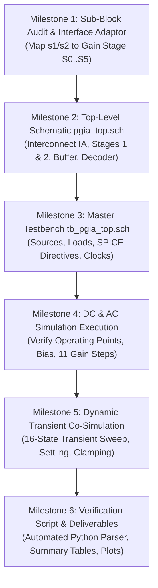

# Implementation Plan: Top-Level PGIA Master Schematic & SPICE Co-Simulation

## 1. Executive Summary & Objective

This plan outlines the architecture, schematic hierarchy, interface contracts, and simulation battery for creating the **master top-level schematic (`pgia_top.sch`)** and **master co-simulation testbench (`tb_pgia_top.sch`)** in **Xschem** for the complete Programmable Instrumentation Amplifier (PGIA) on **IHP SG13CMOS5L**.

The goal is to perform full-chip mixed-signal co-simulation verifying that:

1. The digital decoder macro ([`gain_decoder_4b`](file:///home/ranantalden/Projects/Designs/Chipalooza/Programmable-Instrumentation-Amplifier-IP/xschem/gain_decoder_4b/gain_decoder_4b.sym)) correctly decodes `gain_sel[3:0]` from digital pads and steers the analog gain stages.
2. The front-end fixed instrumentation amplifier ([`instramp_cmos5l`](file:///home/ranantalden/Projects/Designs/Chipalooza/Programmable-Instrumentation-Amplifier-IP/xschem/instramp_cmos5l/instramp_cmos5l.sch), $8\times$ / $18.06\,\text{dB}$) accepts microvolt-level differential signals from East dedicated pads (`s9_an[0..1]`).
3. The cascaded programmable gain stages ([`gain_stage_1`](file:///home/ranantalden/Projects/Designs/Chipalooza/Programmable-Instrumentation-Amplifier-IP/xschem/gain_stage/gain_network.sch) & `gain_stage_2`, $1\times \dots 32\times$ each) seamlessly scale the signal without saturation, instability, or common-mode drift.
4. The high-drive unity-gain buffer ([`output_buffer`](file:///home/ranantalden/Projects/Designs/Chipalooza/Programmable-Instrumentation-Amplifier-IP/xschem/output_buffer/output_buffer.sch)) drives external pad/package loads on East dedicated pad `s9_an[2]` (`VOUT`).
5. Out-of-range gain codes ($11 \dots 15$) safely clamp to the lowest gain level ($8\times$ / $18.06\,\text{dB}$) without floating high-impedance states.

---

## 2. Block Audit & Interface Matrix

```
                      ┌────────────────────────────────────────────────────────┐
                      │                        pgia_top                        │
                      │                                                        │
                      │   ┌──────────────────┐   s1[4:0], s1_b[4:0]            │
dig_in[3:0] ──────────┼──►│ gain_decoder_4b  ├────────────────────────┐        │
(gain_sel[3:0])       │   │  (1.2V Digital)  ├───────────┐            │        │
                      │   └──────────────────┘           │ s2, s2_b   │        │
                      │                                  │            ▼        │
                      │   ┌──────────────────┐      ┌────┴──────┐ ┌──────────┐ │
s9_an[0] (VINP) ──────┼──►│  instramp_cmos5l ├─────►│gain_stage1├►│gain_stage│ │
s9_an[1] (VINN) ──────┼──►│ (Fixed 8x / 18dB)│ V_IA │(1x to 32x)│ │2(1x..32x)│ │
                      │   └──────────────────┘      └───────────┘ └────┬─────┘ │
                      │                                                │       │
                      │   ┌──────────────────┐                         ▼       │
                      │   │  central_bias    │      ┌────────────────────────┐ │
                      │   │  (IBIAS distro)  ├─────►│     output_buffer      ├─┼──► s9_an[2] (VOUT)
                      │   └──────────────────┘      │      (Unity Gain)      │ │
                      └────────────────────────────────────────────────────────┘
```

### Sub-Block Specifications:

| Sub-Block                     | Xschem Schematic / Symbol                                                                                                                                                                  |                            Supply Domain                            | Input Ports                                             | Output Ports                                            | Role in System                                                |
| :---------------------------- | :----------------------------------------------------------------------------------------------------------------------------------------------------------------------------------------- | :------------------------------------------------------------------: | :------------------------------------------------------ | :------------------------------------------------------ | :------------------------------------------------------------ |
| **`gain_decoder_4b`** | [`xschem/gain_decoder_4b/gain_decoder_4b.sym`](file:///home/ranantalden/Projects/Designs/Chipalooza/Programmable-Instrumentation-Amplifier-IP/xschem/gain_decoder_4b/gain_decoder_4b.sym) |       `VPWR` ($1.2\,\text{V}$), `VGND` ($0\,\text{V}$)       | `gain_sel[3:0]`                                       | `s1[4:0]`, `s1_b[4:0]`, `s2[4:0]`, `s2_b[4:0]`  | 4-to-20 line digital steering logic                           |
| **`instramp_cmos5l`** | [`xschem/instramp_cmos5l/instramp_cmos5l.sch`](file:///home/ranantalden/Projects/Designs/Chipalooza/Programmable-Instrumentation-Amplifier-IP/xschem/instramp_cmos5l/instramp_cmos5l.sch) |        `VDD` ($1.2\,\text{V}$), `VSS` ($0\,\text{V}$)        | `VINP`, `VINN`, `CM`, `IBIAS`                   | `VOUT` (single-ended output `V_IA`)                 | Front-end 3-OTA instrumentation amplifier ($8\times$ fixed) |
| **`gain_stage_1`**    | [`xschem/gain_stage/gain_network.sch`](file:///home/ranantalden/Projects/Designs/Chipalooza/Programmable-Instrumentation-Amplifier-IP/xschem/gain_stage/gain_network.sch)                 |       `AVDD` ($1.2\,\text{V}$), `AVSS` ($0\,\text{V}$)       | `V_IN` (`V_IA`), `V_CM`, `I_BIAS`, `S0..S5`   | `V_OUT1`                                              | Programmable stage 1 ($1\times \dots 32\times$)             |
| **`gain_stage_2`**    | [`xschem/gain_stage/gain_network.sch`](file:///home/ranantalden/Projects/Designs/Chipalooza/Programmable-Instrumentation-Amplifier-IP/xschem/gain_stage/gain_network.sch)                 |       `AVDD` ($1.2\,\text{V}$), `AVSS` ($0\,\text{V}$)       | `V_IN` (`V_OUT1`), `V_CM`, `I_BIAS`, `S0..S5` | `V_OUT2`                                              | Programmable stage 2 ($1\times \dots 32\times$)             |
| **`output_buffer`**   | [`xschem/output_buffer/output_buffer.sch`](file:///home/ranantalden/Projects/Designs/Chipalooza/Programmable-Instrumentation-Amplifier-IP/xschem/output_buffer/output_buffer.sch)         | `AVDD` ($1.2\text{--}3.3\,\text{V}$), `AVSS` ($0\,\text{V}$) | `VIN_BUF+` (`V_OUT2`), `IBIAS`                    | `VOUT`                                                | Unity-gain buffer driving external load                       |
| **`central_bias`**    | Dedicated bias cell or reference mirror                                                                                                                                                    |                         `AVDD` / `AVSS`                         | Reference current / $V_{DD}$                          | `IBIAS_IA`, `IBIAS_G1`, `IBIAS_G2`, `IBIAS_BUF` | Distributes $10\,\mu\text{A}$ nominal bias to OTAs          |

### Critical Interface Resolution: Switch Tap Mapping ($S_0 \dots S_5$)

In [`gain_network.sch`](file:///home/ranantalden/Projects/Designs/Chipalooza/Programmable-Instrumentation-Amplifier-IP/xschem/gain_stage/gain_network.sch), the resistor ladder has **6 taps** ($S_0 \dots S_5$):

- $S_0$: $0\,\text{dB}$ ($1\times$ feedback)
- $S_1$: $6\,\text{dB}$ ($2\times$)
- $S_2$: $12\,\text{dB}$ ($4\times$)
- $S_3$: $18\,\text{dB}$ ($8\times$)
- $S_4$: $24\,\text{dB}$ ($16\times$)
- $S_5$: $30\,\text{dB}$ ($32\times$)

The digital decoder outputs **5 bits** per stage (`s1[4:0]`, `s2[4:0]`):

- `s1[0..4]` directly drive taps $S_1 \dots S_5$.
- When all 5 bits are low (`5'b00000`), the stage operates at $1\times$ ($0\,\text{dB}$). Thus:

  $$
  S_0 = \overline{s_1[0] \lor s_1[1] \lor s_1[2] \lor s_1[3] \lor s_1[4]}
  $$

  Because the decoder already provides complementary outputs $s_{1\_b}[0..4]$, $S_0$ can be cleanly synthesized or decoded:

  $$
  S_0 = s_{1\_b}[0] \land s_{1\_b}[1] \land s_{1\_b}[2] \land s_{1\_b}[3] \land s_{1\_b}[4]
  $$

  In `pgia_top.sch`, we will either instantiate a 5-input NOR/AND standard cell or wrap `gain_stage` with a direct 5-bit bus interface (`s1[4:0]`, `s1_b[4:0]`) that drives the transmission gates directly, eliminating redundant inverter overhead.

---

## 3. Top-Level Schematic Architecture (`pgia_top.sch`)

### 3.1 Signal Flow & Floorplan Alignment (Option B)

Following the approved layout floorplan ([`floorplan_implementation_note.md`](file:///home/ranantalden/Projects/Designs/Chipalooza/Programmable-Instrumentation-Amplifier-IP/gds/pgia_top/floorplan_implementation_note.md)):

1. **Lower Lane:** East analog inputs `VINP` / `VINN` enter `instramp_cmos5l`, passing West to `gain_stage_1`.
2. **Turnaround:** Output `V_OUT1` of Stage 1 routes up to `gain_stage_2`.
3. **Upper Lane:** Signal flows Eastward from `gain_stage_2` into `output_buffer` and exits to `s9_an[2]` (`VOUT`).
4. **Digital Control Lane:** `gain_decoder_4b` placed on the West boundary, driving `s1` and `s2` buses along the central routing channel.

### 3.2 Symbol Definition (`pgia_top.sym`)

The symbol encapsulates the complete Chipalooza Slot 9 PGIA IP:

| Pin Group             | Pin Name          |  Type  | Connection in Slot 9 Harness                                     |
| :-------------------- | :---------------- | :----: | :--------------------------------------------------------------- |
| **Analog I/O**  | `VINP`          |   in   | Dedicated Pad `s9_an[0]` (East edge)                           |
|                       | `VINN`          |   in   | Dedicated Pad `s9_an[1]` (East edge)                           |
|                       | `VOUT`          |  out  | Dedicated Pad `s9_an[2]` (East edge)                           |
| **Digital I/O** | `gain_sel[3:0]` |   in   | Digital bus `dig_in[3:0]` (West edge)                          |
| **Reference**   | `VCM`           |   in   | Common-mode bias ($0.6\,\text{V}$)                             |
|                       | `IBIAS_EXT`     |   in   | External bias tuning / test pin                                  |
| **Power Rails** | `AVDD`          | power | Analog power ($1.2\,\text{V}$ core / $3.3\,\text{V}$ buffer) |
|                       | `AVSS`          | ground | Analog quiet ground ($0\,\text{V}$)                            |
|                       | `VPWR`          | power | Digital core power ($1.2\,\text{V}$)                           |
|                       | `VGND`          | ground | Digital return ground ($0\,\text{V}$)                          |

---

## 4. Master Testbench Architecture (`tb_pgia_top.sch`)

The master testbench creates a realistic mixed-signal environment:

```
                            tb_pgia_top.sch
  ┌──────────────────────────────────────────────────────────────────┐
  │                                                                  │
  │  [POWER & BIAS]            [INPUT STIMULUS]                      │
  │  V_AVDD  = 1.2V            V_CM = 0.6V                           │
  │  V_VPWR  = 1.2V            V_DIFF (AC + Transient Sine)          │
  │  V_AVSS  = 0.0V            VINP = V_CM + V_DIFF/2                │
  │  V_VGND  = 0.0V            VINN = V_CM - V_DIFF/2                │
  │  I_BIAS  = 10uA                                                  │
  │                                                                  │
  │  [DIGITAL CONTROL]         ┌───────────────────────┐             │
  │  V_G0..V_G3:               │       pgia_top        │             │
  │  Synchronized Pulses       │  (Instantiated DUT)   │             │
  │  Stepping gain_sel[3:0] ──►│                       ├────► VOUT   │
  │  Codes 0 to 15             └───────────────────────┘       │     │
  │                                                            ▼     │
  │                                                      [OUTPUT LOAD]│
  │                                                      C_L = 15 pF │
  │                                                      R_L = 100 k │
  │                                                                  │
  │  [NGSPICE CONTROL BLOCK]                                         │
  │  .op / .ac / .tran / remzerovec / automated measurements         │
  └──────────────────────────────────────────────────────────────────┘
```

### Key Elements of the Testbench:

1. **Differential Signal Generator:**
   - Common-mode bias: $V_{CM} = 0.6\,\text{V}$ (half of $1.2\,\text{V}$).
   - Small-signal AC differential source: `Vac = 1.0V` across `VINP` and `VINN` for `.ac` analysis.
   - Transient differential source: $V_{in}(t) = V_{peak} \sin(2\pi \cdot 1\,\text{kHz} \cdot t)$.
     - *Design Note on Input Amplitude:* At maximum gain ($78.26\,\text{dB}$ / $8192\times$), the maximum linear differential input before hitting $1.0\,\text{V}_{pp}$ output swing is:
       $$
       V_{in,max} = \frac{0.8\,\text{V}}{8192} \approx 97.6\,\mu\text{V}_{pp} \quad (48.8\,\mu\text{V}_{\text{peak}})
       $$
     - Therefore, testing will use $V_{peak} = 40\,\mu\text{V}$ for the full sweep, and larger amplitudes ($1\text{--}5\,\text{mV}$) for lower gain ranges ($0\dots 4$).
2. **Synchronized 4-Bit Code Generator:**
   - 4 synchronized pulse sources stepping `gain_sel[3:0]` every $100\,\mu\text{s}$ through states $0 \dots 15$.
3. **Realistic Package & Board Load:**
   - $C_L = 15\,\text{pF}$ (pad parasitic $\sim 2\,\text{pF}$ + package pin $\sim 3\,\text{pF}$ + scope probe / trace $\sim 10\,\text{pF}$).
   - $R_L = 100\,\text{k}\Omega$ (standard oscilloscope / ADC input impedance).

---

## 5. Comprehensive Verification Battery

The master co-simulation executes five distinct analysis phases:

### Phase A: DC Operating Point & Bias Audit (`.op`)

- **Objectives:**
  - Verify all OTAs (IA `x1..x3`, Stage 1 OTA, Stage 2 OTA, Buffer) operate with all transistors in saturation ($V_{ds} \ge V_{ds,sat}$).
  - Confirm quiescent output settles to $V_{CM} = 0.600\,\text{V} \pm 5\,\text{mV}$.
  - Calculate total static power consumption across all 4 supply rails ($P_{static} < 500\,\mu\text{W}$).

### Phase B: Closed-Loop AC Frequency Response (`.ac`)

- **Objectives:**
  - Sweep frequency from $10\,\text{Hz}$ to $100\,\text{MHz}$ for each valid gain setting ($0 \dots 10$).
  - Measure differential voltage gain $A_v(f) = 20 \log_{10} \left| \frac{V_{OUT}(f)}{V_{INP}(f) - V_{INN}(f)} \right|$.
  - Verify gain values match targets:
    - Step 0 (`0000`): $18.06\,\text{dB}$ ($8\times$)
    - Step 1 (`0001`): $24.08\,\text{dB}$ ($16\times$)
    - Step 2 (`0010`): $30.10\,\text{dB}$ ($32\times$)
    - Step 3 (`0011`): $36.12\,\text{dB}$ ($64\times$)
    - Step 4 (`0100`): $42.14\,\text{dB}$ ($128\times$)
    - Step 5 (`0101`): $48.16\,\text{dB}$ ($256\times$)
    - Step 6 (`0110`): $54.18\,\text{dB}$ ($512\times$)
    - Step 7 (`0111`): $60.20\,\text{dB}$ ($1024\times$)
    - Step 8 (`1000`): $66.22\,\text{dB}$ ($2048\times$)
    - Step 9 (`1001`): $72.24\,\text{dB}$ ($4096\times$)
    - Step 10 (`1010`): $78.26\,\text{dB}$ ($8192\times$)
  - Measure $-3\,\text{dB}$ bandwidth per gain step and confirm no peak resonance ($Q \le 1.0$).

### Phase C: Dynamic Gain-Stepping Transient Co-Simulation (`.tran`)

- **Objectives:**
  - Run a complete transient simulation over $1.6\,\text{ms}$ ($100\,\mu\text{s}$ per state) as `gain_sel` steps from 0 to 15.
  - Observe continuous sinusoidal output swelling in amplitude cleanly as gain steps up.
  - Verify switching transient settling time ($t_{settle} < 5\,\mu\text{s}$ to within $1\%$ of final value).
  - Verify that out-of-range codes ($11 \dots 15$) immediately clamp back to $18.06\,\text{dB}$ without glitches, rail sticking, or oscillations.

### Phase D: Common-Mode Rejection Ratio (`CMRR`) & PSRR

- **Objectives:**
  - Apply $V_{in,cm} = 1.0\,\text{V}$ AC in phase on `VINP` and `VINN`.
  - Calculate $\text{CMRR}(f) = A_{diff}(f) - A_{cm}(f)$. Target: $\text{CMRR} \ge 80\,\text{dB}$ at $50/60\,\text{Hz}$ and $1\,\text{kHz}$.
  - Apply $100\,\text{mV}$ AC ripple on `AVDD` and `VPWR` to measure $\text{PSRR}^+$ and $\text{PSRR}^-$.

### Phase E: Linearity & Harmonic Distortion (THD / FFT)

- **Objectives:**
  - Apply a $1\,\text{kHz}$ input tone producing $0.8\,\text{V}_{pp}$ output swing.
  - Compute 1024-point FFT in ngspice and measure Total Harmonic Distortion (THD). Target: $\text{THD} < -50\,\text{dB}$ ($< 0.3\%$).

---

## 6. Target Specifications & Pass/Fail Criteria

| Performance Metric                | Condition / Setting                                |                            Target Specification                            |           Minimum Acceptable           |
| :-------------------------------- | :------------------------------------------------- | :------------------------------------------------------------------------: | :-------------------------------------: |
| **Gain Range**              | Step 0 to Step 10                                  | $18.06\,\text{dB} \dots 78.26\,\text{dB}$ ($8\times \dots 8192\times$) |            Complete 11 steps            |
| **Gain Step Error**         | Per nominal $6\,\text{dB}$ step                  |                        $\le \pm 0.15\,\text{dB}$                        |       $\le \pm 0.30\,\text{dB}$       |
| **Small-Signal Bandwidth**  | At $18.06\,\text{dB}$ (Step 0)                   |                           $> 2.0\,\text{MHz}$                           |          $> 1.0\,\text{MHz}$          |
|                                   | At $78.26\,\text{dB}$ (Step 10)                  |                            $> 15\,\text{kHz}$                            |          $> 10\,\text{kHz}$          |
| **CMRR (Low Frequency)**    | $f \le 1\,\text{kHz}$, Step 0                    |                           $\ge 85\,\text{dB}$                           |          $\ge 75\,\text{dB}$          |
| **Output Voltage Swing**    | $R_L = 100\,\text{k}\Omega, C_L = 15\,\text{pF}$ |      $0.20\,\text{V} \dots 1.00\,\text{V}$ ($0.8\,\text{V}_{pp}$)      | $0.25\,\text{V} \dots 0.95\,\text{V}$ |
| **Quiescent Output Offset** | Differential inputs tied to $V_{CM}$             |                   $|V_{OUT} - V_{CM}| < 5\,\text{mV}$                   |           $< 15\,\text{mV}$           |
| **Clamping Behavior**       | Codes $11 \dots 15$                              |                  Clamped to Step 0 ($18.06\,\text{dB}$)                  |       Stable non-floating output       |
| **Total Power Dissipation** | Static DC, nominal bias                            |                           $< 350\,\mu\text{W}$                           |         $< 600\,\mu\text{W}$         |

---

## 7. Phased Implementation Roadmap



### Detailed Milestone Checklist:

- [X] **Milestone 1: Sub-Block Interface Adaptation**
  - Verify pin contracts of `instramp_cmos5l`, `gain_network`, `output_buffer`, `gain_decoder_4b`.
  - Finalize $S_0$ tap logic for Gain Stage 1 and Stage 2 ($1\times$ feedback when `s1` or `s2` is zero).
- [ ] **Milestone 2: Top-Level Schematic Assembly (`pgia_top.sch` & `pgia_top.sym`)**
  - Create directory `xschem/pgia_top/`.
  - Draw `pgia_top.sch` implementing the Folded Two-Lane signal path.
  - Generate hierarchical symbol `pgia_top.sym` with all external pad pins.
- [ ] **Milestone 3: Master Testbench Construction (`tb_pgia_top.sch`)**
  - Draw `tb_pgia_top.sch` instantiating `pgia_top.sym`.
  - Add dual analog differential stimulus + digital 4-bit synchronous pulse sweep.
  - Netlist cleanly with Xschem batch command in Docker `iic-osic-tools_x11`.
- [ ] **Milestone 4: DC Operating Point & AC Performance Verification**
  - Run ngspice batch simulation for `.op` and `.ac`.
  - Extract gain curve, $-3\,\text{dB}$ bandwidth, and phase margin across all 11 settings.
- [ ] **Milestone 5: Dynamic Transient Co-Simulation**
  - Run full mixed-signal transient sweep across all 16 states ($0\dots 15$).
  - Verify seamless gain transitions, low switching glitch energy, and safe clamping on states 11–15.
- [ ] **Milestone 6: Post-Processing & Documentation**
  - Create Python verification script `verify_pgia_top.py` to parse raw SPICE data and compute metrics.
  - Document results with waveform plots and sign-off report in `xschem/pgia_top/README.md`.
