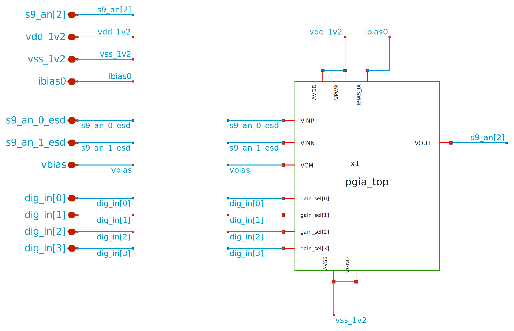
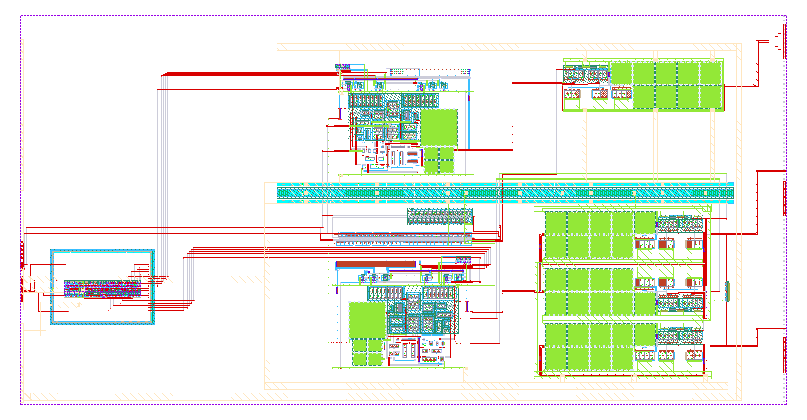

# slot9_wrapper

<!-- AUTO:schematic:slot9_wrapper -->

**Parameters** (`.param` of the schematic and of the cells it instantiates; generated by `scripts/update_images.py`, do not edit)

| Source | Parameter | Value |
|---|---|---|
| ota_cmos5l (x1, x2, x3) | `temp` | `27` |
| ota_cmos5l (x1, x2, x3) | `lbias` | `0.15u` |
| ota_cmos5l (x1, x2, x3) | `wbias` | `0.15u` |
| ota_cmos5l (x1, x2, x3) | `m6` | `1` |
| ota_cmos5l (x1, x2, x3) | `m7` | `4` |
| ota_cmos5l (x1, x2, x3) | `m8` | `8` |
| ota_cmos5l (x1, x2, x3) | `linpair` | `3u` |
| ota_cmos5l (x1, x2, x3) | `winpair` | `20u` |
| ota_cmos5l (x1, x2, x3) | `lload` | `5u` |
| ota_cmos5l (x1, x2, x3) | `wload` | `10u` |
| ota_cmos5l (x1, x2, x3) | `lcs` | `3u` |
| ota_cmos5l (x1, x2, x3) | `wcs` | `20u` |
| ota_cmos5l (x1, x2, x3) | `Cc` | `2p` |
<!-- /AUTO -->

<!-- AUTO:layout:slot9_wrapper -->
### Layout

**Physical size** (bounding box of `slot9_wrapper`; generated by `scripts/update_images.py`)

| Width W | Length L | Area |
|---|---|---|
| 537.15 µm | 273.00 µm | 146642 µm² |
<!-- /AUTO -->

